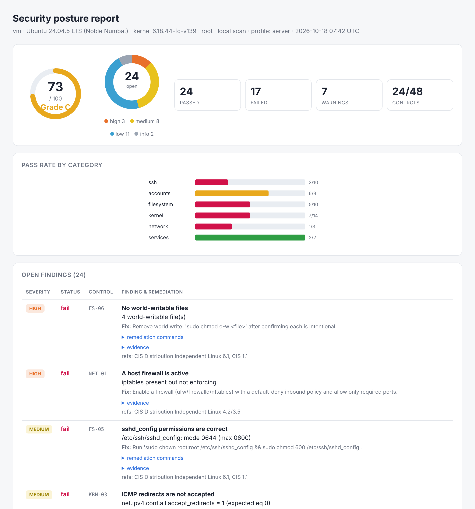

# SecPosture


A security posture auditor for Linux hosts. It benchmarks a machine you run
against hardening controls (CIS-style), cross-checks installed packages against
known-vulnerability data, scores the result and tells you exactly what to fix.
It audits the **local host** or a **remote host you administer over SSH**, and
it is strictly read-only: it observes configuration and makes no changes to the
target.



## Where it fits

This is the assessment-and-hardening side of security work: the part of a
penetration test or security review that inventories a system's weaknesses and
produces a prioritized remediation plan. It identifies and reports exposure; it
does not exploit it, carry attack payloads, or act against systems you do not
control (active checks only run against the host you point it at). That makes it
safe to run on your own fleet and safe to publish.

## Features

- **51 hardening controls** across SSH, accounts & password policy, filesystem
  permissions, kernel/sysctl, network exposure and services - each with a
  severity, rationale, references and concrete remediation.
- **Local and remote (SSH) auditing** from one tool. The remote collector
  verifies the host key against `known_hosts` (no blind trust), reads files over
  SFTP and runs only a fixed, read-only command allowlist.
- **Known-vulnerability scanning** of installed packages against
  [OSV](https://osv.dev)-format advisories, with correct native **dpkg** and
  **rpm** version comparison and a built-in **CVSS 3.1** base-score calculator.
- **Posture score & grade (A-F)** - severity-weighted, so one critical finding
  outweighs many trivial ones.
- **Reports**: a rich terminal summary, a signed JSON result, and a
  self-contained HTML report (inline SVG charts, no external assets - works
  air-gapped).
- **Review-only remediation script** generated from the findings. It never runs
  itself and refuses to run until you pass `--i-have-reviewed-this`; every
  target-derived value in it is shell-quoted.
- **Baselines & drift**: save a baseline and diff later to catch regressions
  (`--fail-under` gates CI).
- **Fleet dashboard** (optional): a password-protected Streamlit app that loads
  signed results from many hosts and shows fleet posture, per-host trend and
  findings.

## Quick start

```bash
git clone https://github.com/nlevenov/SecPosture.git
cd SecPosture
python -m venv .venv && source .venv/bin/activate
pip install -e ".[dev,dashboard]"

secposture audit --html --remediation      # audit this host, write a report
```

Audit a remote host you administer:

```bash
secposture audit --ssh ubuntu@10.0.0.20 --key ~/.ssh/id_ed25519 \
  --known-hosts ~/.ssh/known_hosts --save --html
```

Running as root (or over SSH as root) lets it read root-only files such as
`/etc/shadow`; unprivileged runs still work and clearly mark what they could
not read.

## CLI

| Command | Purpose |
|---------|---------|
| `secposture audit [--ssh USER@HOST]` | Run an audit. `--save` (signed JSON), `--html`, `--remediation`, `--all`, `--profile`, `--fail-under SCORE` |
| `secposture report RESULT.sp.json` | Re-render an HTML report from a saved result |
| `secposture controls [--json]` | List the control catalog |
| `secposture baseline save\|diff FILE` | Save a baseline, or diff the host against one |
| `secposture dashboard` | Start the fleet dashboard |
| `secposture hash-password` | Create the dashboard password hash |

SSH options: `--port`, `--key`, `--known-hosts`, `--ask-pass`.

## Example output

```
========================================================================
  SecPosture audit  -  web01  (ssh)
========================================================================
  Ubuntu 22.04.4 LTS  kernel 5.15.0-101  root
  Posture score: 73/100   Grade: C   Controls passed: 24/48   Profile: server
  Open findings by severity:  high:3  medium:8  low:11  info:2

  FAIL  [high    ] NET-01   A host firewall is active
         no active host firewall detected
  FAIL  [medium  ] SSH-02   SSH uses key-based authentication
         PasswordAuthentication yes
  ...
```

## Control catalog (summary)

| Category | Examples |
|----------|----------|
| **SSH** | root login restricted, key-only auth, empty passwords rejected, MaxAuthTries, idle timeout, weak cipher/MAC/KEX detection, rhosts/host-based auth, verbose logging |
| **Accounts** | single UID-0, no empty passwords, strong hashing (SHA512/yescrypt), password aging, restrictive umask, system accounts have no shell, shadowed hashes, duplicate UIDs, sudo review |
| **Filesystem** | `/etc/passwd,shadow,group,gshadow,sshd_config` permissions, no world-writable files, sticky-bit dirs, unowned files, unexpected SUID/SGID review, `/tmp` mount options, bootloader perms |
| **Kernel** | ASLR, IP forwarding, ICMP redirects, source routing, SYN cookies, rp_filter, kptr/dmesg restrict, ptrace scope, suid_dumpable, link protection |
| **Network** | host firewall active, no cleartext/legacy services listening, externally reachable ports reviewed |
| **Services** | no insecure service packages installed, running-service review |
| **Packages** | installed packages matched against known CVEs (OSV) |

`secposture controls` prints the full list.

## Configuration

`config/settings.yaml` (all optional; `${ENV_VAR}` expansion keeps secrets out
of the file). Key settings: `profile`, `disabled_controls` (accepted risks),
`allowed_suid` / `allowed_listen_ports` (expected items), `signing_key`, the
`ssh` block, the `advisories` feed, scoring cut-offs and the dashboard.

### Advisory feed

The bundled `src/secposture/data/advisories/` contains one real example (the
"Baron Samedit" sudo CVE) so the feature works out of the box. **Replace it
with a real feed** for production - an export of the OSV database for your
distribution, or enable the live API with `advisories.use_osv_api: true`. See
`src/secposture/data/advisories/README.md`.

## Security

SecPosture is a security tool and is built to be safe to point at a host:

- **Read-only by construction.** Collectors expose only read-file, stat,
  list-dir and a fixed read-only command allowlist. No caller-supplied command
  ever runs; no target value is interpolated into a command line.
- **SSH.** Host keys are verified against `known_hosts` (unknown key = abort),
  files are read over SFTP, and the SSH target is strictly validated so it can
  never carry shell metacharacters or option-like values.
- **Hostile data.** Everything read from a target is treated as untrusted:
  bounded, stripped of control characters (so terminal output cannot be
  hijacked) and HTML-escaped in the report. Values interpolated into the
  generated remediation script are shell-quoted.
- **Integrity.** Saved results and baselines carry an HMAC signature (or a
  SHA-256 checksum without a key); the dashboard flags any result that fails
  verification.
- **Dashboard.** scrypt password, fails closed when none is set, brute-force
  lockout, session expiry, XSRF protection, SameSite=Strict cookie and a Host
  allow-list against DNS rebinding.
- **CI** runs ruff, bandit, pip-audit and the full test suite (including real
  SSH integration and privilege handling) on every push.

Full threat model: [SECURITY.md](SECURITY.md).

## Project layout

```
src/secposture/
  collectors/   read-only local & SSH fact gathering (fixed command allowlist)
  controls/     the hardening control catalog (pure functions over facts)
  advisories/   OSV matching, dpkg/rpm version comparison, CVSS 3.1
  report/       terminal, HTML (inline SVG), remediation script
  dashboard/    fleet dashboard (Streamlit) with login gate
  audit.py      collect -> evaluate -> score
  scoring.py    severity-weighted posture score & grade
  results.py    signed, integrity-checked serialization
  baseline.py   drift diffing
config/         settings.yaml
tests/          pytest suite (105 tests, incl. real SSH integration)
```

## Development

```bash
make dev        # editable install with test + audit tools
make test       # pytest (run as root to include the SSH integration test)
make lint       # ruff
make security   # bandit + pip-audit
```

## Roadmap

- More profiles (CIS Level 1 / Level 2 mapping, container-host profile)
- Additional collectors (auditd, PAM, AppArmor/SELinux state)
- Scheduled audits with history retention and e-mail/webhook summaries
- Signed, distributable advisory bundles per distribution

## License

MIT - see [LICENSE](LICENSE).
